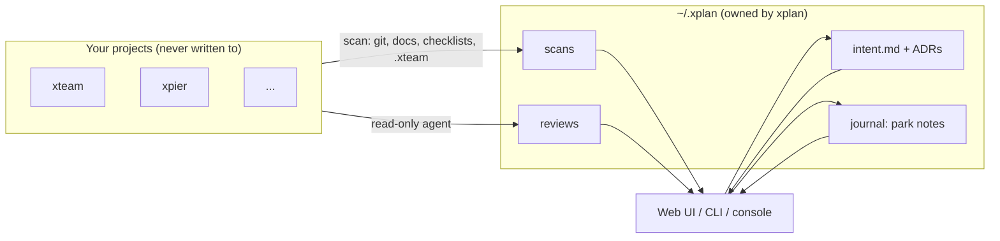
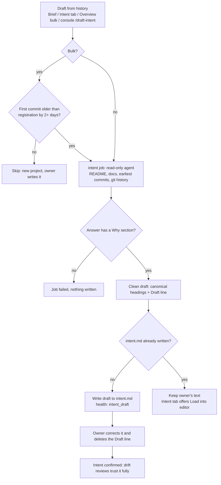
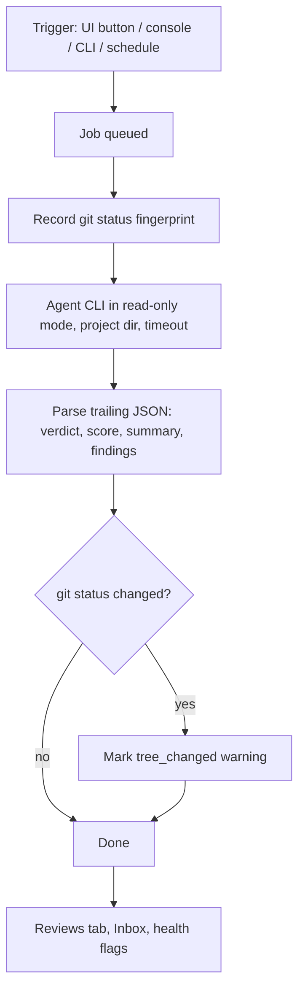
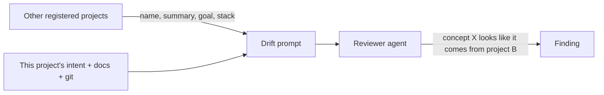
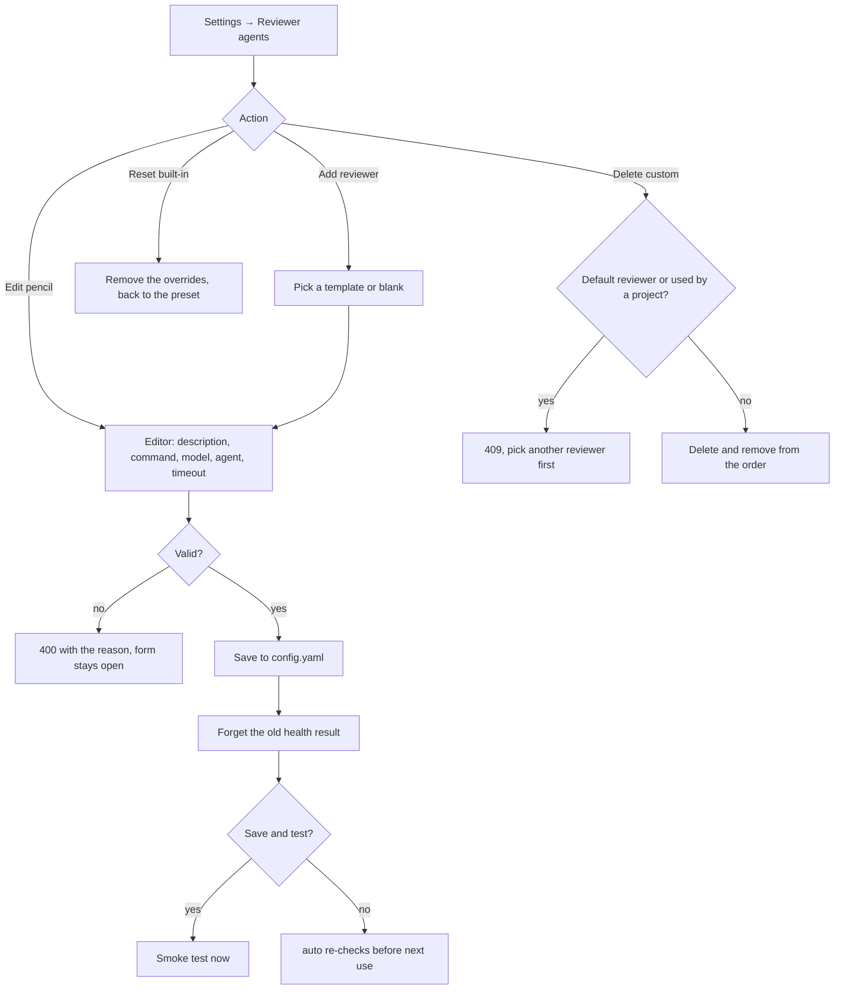
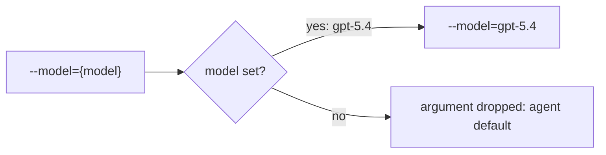
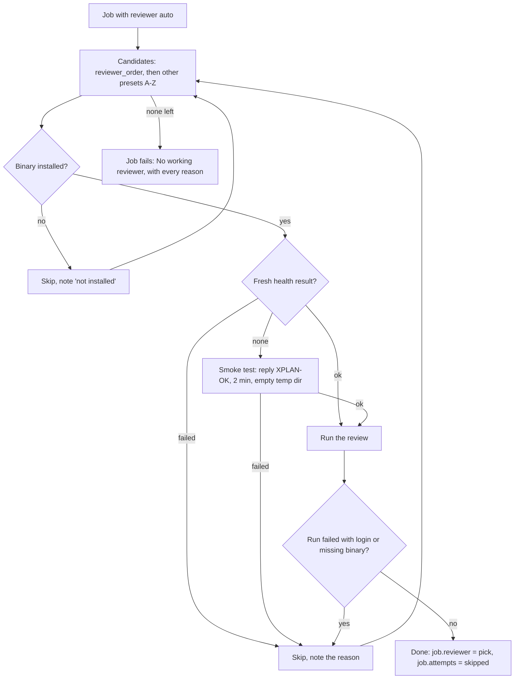
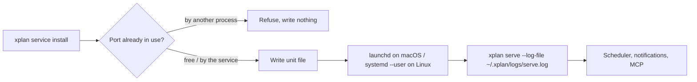
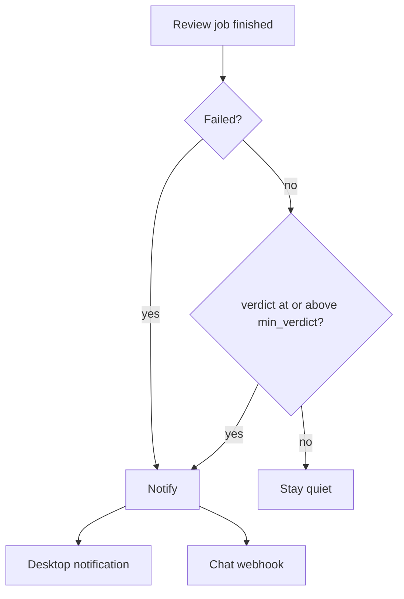
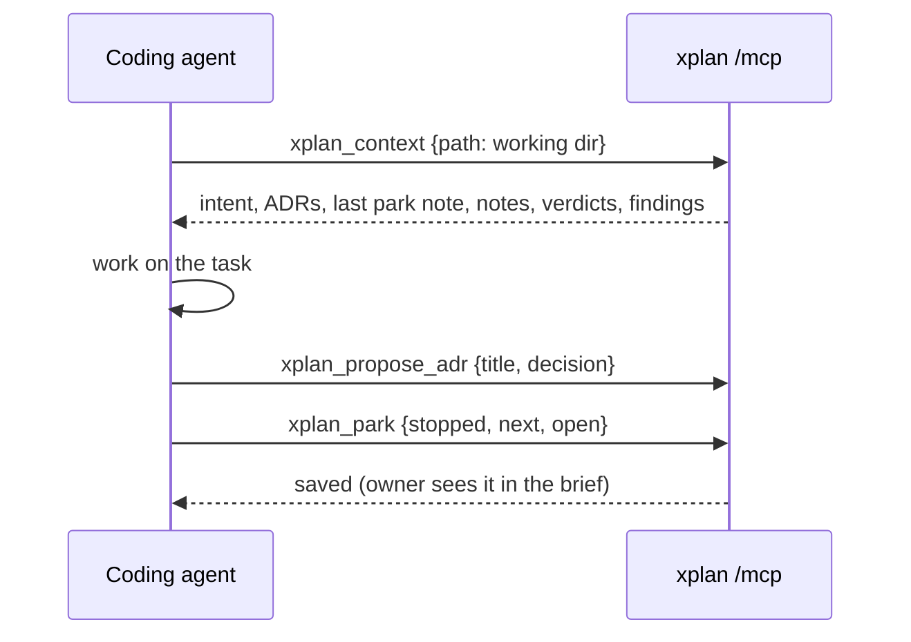

# xplan Features

This file lists every feature of xplan: what it is for, how to use it, its
parameters and what it returns. The design rationale and flowcharts live in
[docs/design.md](docs/design.md).

## 1. Overview

| Area            | What it gives you                                                                |
| --------------- | -------------------------------------------------------------------------------- |
| Registry        | One folder per project under `~/.xplan/projects/<slug>/`                         |
| Intent and ADRs | Why the project exists and the decisions taken, stored outside the project       |
| Scanner         | Git activity, docs by kind, checklist progress, `.xteam` slices, stack           |
| Health          | Flags such as "intent not written", "active but stale", "review needs attention" |
| Re-entry brief  | Intent → park note → what changed since your last visit → health → reviews       |
| Reviews         | Read-only agent reviews: drift, code, security, deploy, test, ask, intent drafts |
| Console         | Slash commands and free-form questions per project                               |
| Web UI          | IDE layout: sidebar, tabs, board, inbox, palette (⌘K), console (⌘J)              |
| Service         | `xplan service install` keeps it running at login, so scheduled reviews run      |
| Notifications   | Desktop or chat webhook when a review needs attention or fails                   |
| Agent memory    | MCP endpoint: agents read intent, decisions, park notes; write notes and ADRs    |

## 2. Registry

### 2.1 Register a project

- **UI**: `+` in the sidebar, or ⌘K → "Add project". Paste a folder path, or
  "Discover" a root folder and tick the repositories to add.
- **CLI**: `xplan add <path> [--name NAME]`, `xplan discover <root> [--add]`.
- **API**: `POST /api/projects` with `{"path": "...", "name": "optional"}` →
  `201` with the project. `POST /api/discover` with `{"root": "..."}` → `200`
  with the git repositories found and whether each is registered.

Registration copies the global default schedule into the project, seeds
`intent.md` from a template, takes the summary from the README's first real
sentence (links, HTML and badge lines stripped) and runs a first scan.

### 2.2 Project fields (`project.yaml`)

| Field       | Type             | Meaning                                                         |
| ----------- | ---------------- | --------------------------------------------------------------- |
| `name`      | string           | Display name                                                    |
| `path`      | string           | Absolute path of the project directory                          |
| `status`    | enum             | `active`, `waiting`, `blocked`, `paused`, `done` (board column) |
| `summary`   | string           | One line shown under the name                                   |
| `tags`      | string[]         | Free tags                                                       |
| `reviewer`  | string           | Reviewer preset; empty means the global default                 |
| `schedule`  | map kind → value | `off`, `daily` or `weekly` per review kind                      |
| `doc_globs` | string[]         | Extra globs to collect as docs (relative to the project root)   |

`PATCH /api/projects/{slug}` accepts any subset of these fields (except `path`)
and returns `200` with the updated project. `DELETE /api/projects/{slug}` moves
the project's xplan folder to `~/.xplan/archive/` (nothing is deleted) and
returns `204`.

## 3. Intent and decisions

- **Intent** (`intent.md`): sections Why, Goal, Success, Non-goals, Context.
  The Brief tab shows the first four. Edit in the Intent tab (edit, split or
  preview; ⌘S saves).
  - `GET /api/projects/{slug}/intent` → `{"content": "..."}`
  - `PUT /api/projects/{slug}/intent` with `{"content": "..."}` → `200`
- **Intent drafts for existing projects**: new projects get their intent from
  the owner; projects that existed before they were registered can have the
  reviewer reconstruct it first (see 3.1).
- **ADRs** (`adr/NNNN-title.md`): portfolio-level decisions. The Decisions tab
  also lists the project's own ADR and spec documents (read-only).
  - `POST /api/projects/{slug}/adrs` with `{"title": "...", "context": "..."}` → `201`
  - `PUT /api/projects/{slug}/adrs/{id}` with `{"content": "..."}` → `200`

### 3.1 Intent drafts

| Rule                                                                                           | Why                                                                                                  |
| ---------------------------------------------------------------------------------------------- | ---------------------------------------------------------------------------------------------------- |
| Only an **empty** intent is filled in; a written one is never overwritten                      | Your own words always win                                                                            |
| The draft starts with a `> **Draft** — inferred by …` line                                     | Health shows `intent_draft` and drift reviews treat the intent as low-confidence until you delete it |
| Bulk drafting only covers projects whose first commit is 2+ days older than their registration | Projects started together with their xplan entry are written by the owner                            |
| The prompt includes the 15 earliest commits                                                    | The original motivation is usually in the first commits and the first README                         |

- **Start one**: "Draft from history" in the Brief card or the Intent tab,
  ⌘K → "Draft intent from history", `/draft-intent`, or
  `POST /api/projects/{slug}/reviews` with `{"kind": "intent"}` → `202`.
- **Start in bulk**: "Draft missing intents (N)" on the Overview, or
  `POST /api/intent-drafts` → `202` with
  `{"queued": [{"project", "code": "queued", "job_id"}], "skipped": [{"project", "code", "reason"}]}`.
  `code` is `filled`, `new`, `running` or `error` for skipped projects.
- **Result**: the job's report is the clean draft; `intent_written: true` means
  it filled `intent.md`. `GET /api/projects/{slug}/intent` returns
  `{"content", "filled", "draft"}`.
- **Failure**: an answer without a `## Why` section fails the job and writes
  nothing.

## 4. Scanner and health

A scan runs on registration, every `scan_interval` (default `15m`), on "Rescan",
on `/scan` and on `xplan scan`. It collects:

| Source         | Collected                                                              |
| -------------- | ---------------------------------------------------------------------- |
| git            | Branch, HEAD, recent commits, uncommitted file count, last commit      |
| Docs           | README, CHANGELOG, specs, ADRs, progress, agent instructions, `.xteam` |
| Checklists     | `- [x]` vs `- [ ]` counts per doc and overall progress                 |
| `.xteam/tasks` | Stage of every slice (open vs done)                                    |
| Stack          | `go.mod`, `composer.json`, `package.json`, Xcode, CI workflows, ...    |

`POST /api/projects/{slug}/scan` → `200` with `scanned_at` and counts.

Health flags (most severe first): `path_missing` (crit), `no_intent`,
`intent_draft` (the intent still carries the agent's Draft line), `stale`
(active but no commit for 14 days), `dirty` (more than 30 files is a warning),
`review_<kind>` (latest verdict attention or critical), `review_failed_<kind>`,
`no_park`, `xteam_open`, `never_scanned`.

## 5. Re-entry brief and park notes

- **Brief tab**: intent card, last park note, "Since your last visit" (commits and
  changed docs since the recorded HEAD), health, latest review per kind,
  checklist progress, decisions.
- **I'm caught up**: `POST /api/projects/{slug}/visit` records now + HEAD.
- **Park note** (before switching away): where you stopped, the next step, open
  questions. The UI's Park button, `/park stopped | next | open`, or
  `xplan park <slug> "stopped | next | open"`. Writing a park note also records
  the visit.
- **Journal**: `GET /api/projects/{slug}/journal?kind=&limit=` →
  `{"entries": [...]}`; `POST` with `{"kind": "park|note", "text", "stopped",
"next", "open"}` → `201`.

## 6. Reviews

| Kind       | Question it answers                                                                |
| ---------- | ---------------------------------------------------------------------------------- |
| `drift`    | Is the project still doing what its intent says? Any concepts from other projects? |
| `code`     | Structure, correctness risks, maintainability                                      |
| `security` | Secrets, injection, auth, dependency risks                                         |
| `deploy`   | Build, configuration, release and rollback readiness                               |
| `test`     | Coverage of critical paths, flaky or missing tests                                 |
| `ask`      | Free-form question (console plain text)                                            |
| `intent`   | Intent draft for an existing project (no verdict; see 3.1)                         |

- **Start**: `POST /api/projects/{slug}/reviews` with `{"kind": "drift"}` or
  `{"kind": "ask", "question": "..."}` → `202` with the job. `409` if the same
  kind is already running for the project.
- **Read**: `GET /api/projects/{slug}/reviews` → `{"jobs": [...]}`;
  `GET /api/projects/{slug}/reviews/{id}` → `{"job", "report"}`; the job has
  `findings`, `verdict` (`ok`, `attention`, `critical`, or `unknown` when the
  agent returned no JSON; drift reviews display them as aligned, drifting and
  off-track), `score` (0–100) and `tree_changed`.
- **Cancel**: `POST /api/projects/{slug}/reviews/{id}/cancel` → `202`.
- **Inbox**: `GET /api/inbox` → open findings across projects, newest first.
- **Report links**: file references such as `/abs/project/bin/x.py:584` open
  the file in the Docs tab; paths outside the project render as plain text.
- **Drift and other projects**: a drift prompt also lists up to 8 other
  registered projects (name, summary, the Goal bullets of their intent, stack,
  tags, last activity), most recently active first. The reviewer uses them only
  to spot concepts borrowed from a sibling project and must name the project
  each one seems to come from. Shared generic technology (same language or
  framework) is not counted. Other review kinds do not get this list.

### Reviewer presets

Every preset runs the agent read-only. The mechanism differs per agent:

| Preset         | Command (argv template)                                                                                                                                                      | How it stays read-only                                                                   | Model / agent                        |
| -------------- | ---------------------------------------------------------------------------------------------------------------------------------------------------------------------------- | ---------------------------------------------------------------------------------------- | ------------------------------------ |
| `cursor-agent` | `cursor-agent -p --output-format text --mode ask --trust --workspace {path} --model={model} {prompt}`                                                                        | Ask mode                                                                                 | model                                |
| `codex`        | `codex exec --sandbox read-only --skip-git-repo-check -C {path} --model={model} {prompt}`                                                                                    | Read-only sandbox                                                                        | model                                |
| `claude`       | `claude -p {prompt} --tools=Read,Grep,Glob --allowedTools=Read,Grep,Glob --disallowedTools=Edit,Write,Bash,NotebookEdit --strict-mcp-config --model={model} --agent={agent}` | Hard tool allowlist; the user's MCP servers are not loaded                               | model, agent                         |
| `kimi`         | `kimi -p {prompt} --agent-file {xplan_home}/agents/kimi-readonly.md --model={model}`                                                                                         | `-p` auto-approves every tool, so the agent profile only has Read, Grep and Glob         | model (agent is fixed)               |
| `gemini`       | `gemini -p {prompt} --approval-mode default --model={model}`                                                                                                                 | Headless mode denies tools that need approval. Plan mode is not used: it allows YOLO.    | model                                |
| `qwen`         | `qwen -p {prompt} --approval-mode default --model={model}`                                                                                                                   | Same as gemini                                                                           | model                                |
| `opencode`     | `opencode run --agent={agent} --model={model} {prompt}`                                                                                                                      | Read-only `plan` agent (the default agent value)                                         | model, agent (empty restores `plan`) |
| `kiro`         | `kiro-cli chat --no-interactive --trust-tools=fs_read --agent={agent} --model={model} {prompt}`                                                                              | Only `fs_read` is trusted; other tools need an approval non-interactive mode cannot give | model, agent                         |
| `devin`        | `devin -p {prompt} --permission-mode auto --respect-workspace-trust false --model={model}`                                                                                   | Print mode denies every tool that needs approval (verified: a write request is refused)  | model                                |
| `omp`          | `omp -p --no-session --no-skills --no-extensions --no-rules --no-lsp --no-title --cwd {path} --tools read,grep,glob --model={model} {prompt}`                                | Tool allowlist; skills, extensions, rules and LSP are off, so it starts in seconds       | model                                |

Placeholders: `{prompt}` (prompt text), `{prompt_file}` (path of the prompt file),
`{path}` (project directory), `{xplan_home}` (`~/.xplan`), `{model}` and
`{agent}` (the reviewer's settings). An argument that contains `{model}` or
`{agent}` is **dropped** when that setting is empty, so the agent keeps its own
default. That is why presets use the one-argument form `--model={model}`.

### 6.1 Managing reviewers

Settings → Reviewer agents edits presets and adds any other CLI agent.

- **Built-in presets** store only what you changed (for example
  `omp: {timeout: 40m}`), so new xplan versions still update the rest of the
  command. Clearing a field means "use the preset value". The row shows a
  "changed" badge and a reset button.
- **Custom reviewers** are stored in full and show a "custom" badge. They join
  the end of `reviewer_order`, so `auto` can use them too.
- **Templates** for agents xplan has not verified: `codebuddy` (Tencent
  CodeBuddy Code), `qodercli` (Qoder CLI) and `claude-provider` (Claude Code
  pointed at any Anthropic-compatible provider through
  `~/.xplan/agents/claude-provider.json`, so keys never go into `config.yaml`).
  Each template has a note on what to do first (log in, create the settings file).
- **Validation** (`400`): name `[a-z0-9][a-z0-9._-]{0,39}` and not `auto`; the
  first argument is a program, not a placeholder; the command contains
  `{prompt}` or `{prompt_file}`; no line breaks; model and agent are at most 200
  characters, contain no spaces or braces and do not start with `-` (they are
  values, not extra flags); timeout between `1m` and `24h`.
- **API**:
  - `PUT /api/reviewers/{name}` with `{"description", "command": [...], "model",
"agent", "timeout"}` → `200` `{"reviewers": [...]}`. Creates or updates.
  - `DELETE /api/reviewers/{name}` → `200`; resets a built-in, deletes a custom
    reviewer; `409` when a custom reviewer is the default or a project uses it.
  - `GET /api/meta` → each reviewer has `command`, `model`, `agent`, `timeout`,
    `effective_timeout`, `supports_model`, `supports_agent`, `builtin`,
    `modified`; `reviewer_templates` lists the templates.

### 6.2 Timeouts and silent failures

- **Per-reviewer timeout**: a reviewer's `timeout` overrides `review_timeout`
  (default `20m`). The smoke test always uses 2 minutes.
- **Timeout message**: "No answer within 20m. The agent's model service may be
  down or rate-limited (many agents retry quietly), or the project needs more
  time…", followed by the last lines the agent printed (colors removed).
- **Why it happens**: a slow or free model, a provider answering `429` while the
  agent retries quietly, or a big project. Fixes: pick a faster model, give that
  reviewer a longer timeout, or move a faster reviewer up the order.
- **Silent failures**: an agent that exits with code 0 but prints nothing, or
  prints a short login message (under 800 characters), counts as failed, so
  `auto` moves on instead of saving an empty report.

### 6.3 Choosing a reviewer (`auto`)

`default_reviewer` and a project's `reviewer` may be `auto`: xplan picks the
first working preset at run time, so reviews keep working when one agent is not
installed or not logged in.

- **Health**: stored in `~/.xplan/reviewers-health.json`, one entry per preset:
  `status` (`ok`, `auth`, `missing`, `timeout`, `error`), `detail` (the agent's
  own error line, terminal colors removed), `checked_at`, `duration_ms`,
  `source` (`test` or `run`). A success is trusted for 24 hours, a failure for
  6 hours. Real reviews update it too, but only with clear signals (success,
  login problem, missing binary); a crash or timeout on a big project says
  little about the agent.
- **Login detection**: messages such as "authentication required", "not logged
  in", "401", "api key", "subscription", "quota" or "opening browser" mark the
  preset as `auth` ("needs login or subscription").
- **Test one**: `POST /api/reviewers/{name}/test` → `200`
  `{"name", "health", "health_label"}`; `400` for an unknown preset.
- **Test all**: `POST /api/reviewers/test` → `200` `{"results": {name: health},
"reviewers": [...]}`. Installed presets run in parallel.
- **Meta**: `GET /api/meta` lists `reviewers` in auto order, each with
  `installed`, `health` and `health_label`, plus `reviewer_order` and
  `auto_choice` (`{"name", "verified"}`: what auto would use now, and whether it
  passed a recent check).
- **Jobs**: `reviewer_requested` is `auto` when the pick happened at run time;
  `reviewer` is the pick; `attempts` lists the skipped presets as `name: reason`
  (shown in the review detail).
- **UI**: Settings → Reviewer agents shows the order (arrows, then Save), the
  health badge, the last check, model / agent / timeout chips, and Test, Edit
  and Reset or Delete buttons per reviewer, plus Add reviewer and Test all. The
  status bar shows `auto → codex` and links to Settings.

## 7. Console

Open with ⌘J. Plain text asks the project's reviewer a read-only question.

| Command         | Arguments                                  | Effect                              |
| --------------- | ------------------------------------------ | ----------------------------------- |
| `/review`       | `drift\|code\|security\|deploy\|test\|all` | Start reviews                       |
| `/ask`          | `<question>`                               | Same as plain text                  |
| `/park`         | `stopped [\| next] [\| open]`              | Leave a park note                   |
| `/note`         | `<text>`                                   | Journal note                        |
| `/adr`          | `<title>`                                  | Create an ADR                       |
| `/draft-intent` |                                            | Reconstruct the intent from history |
| `/status`       | `active\|waiting\|blocked\|paused\|done`   | Move on the board                   |
| `/scan`         |                                            | Rescan now                          |
| `/caught-up`    |                                            | Record the visit                    |
| `/xteam`        | `<message>` or `status`                    | Ring the project's xteam PM         |
| `/open`         |                                            | Cursor, VS Code or the file manager |
| `/help`         |                                            | List commands                       |

`/xteam` is listed only when the `xteam` CLI is installed.

API: `POST /api/projects/{slug}/console` with `{"input": "..."}` →
`{"ok", "output", "job_id"?, "job_ids"?, "refresh"?}`; `GET` returns
`{"items": [...]}` (history).

## 8. Global settings (`~/.xplan/config.yaml`)

| Key                      | Default                                                                     | Meaning                                              |
| ------------------------ | --------------------------------------------------------------------------- | ---------------------------------------------------- |
| `listen`                 | `127.0.0.1:7788`                                                            | HTTP address                                         |
| `scan_interval`          | `15m`                                                                       | Background rescan period                             |
| `review_timeout`         | `20m`                                                                       | Per-review timeout (a reviewer's own `timeout` wins) |
| `max_concurrent_reviews` | `2`                                                                         | Parallel reviews                                     |
| `default_reviewer`       | `auto`                                                                      | Used when a project has no reviewer                  |
| `reviewer_order`         | cursor-agent, codex, claude, kimi, gemini, qwen, opencode, kiro, devin, omp | Order `auto` tries reviewers in                      |
| `language`               | `en`                                                                        | UI and server messages: `en` or `zh`                 |
| `report_language`        | `English`                                                                   | Language the agent writes reports in                 |
| `default_schedule`       | drift and security weekly, others off                                       | Copied into newly registered projects                |
| `reviewers`              | empty (presets are built in)                                                | Preset overrides and custom reviewers (see 6.1)      |
| `notify`                 | desktop on, `min_verdict: attention`, no webhook                            | Notifications (see 10)                               |

`GET /api/config`, `PATCH /api/config` (any subset of the editable keys).
Reviewers are edited through `PUT` / `DELETE /api/reviewers/{name}` instead.
Commands that v0.1–v0.3 wrote in full for built-in presets are recognized and
dropped on load, so those presets pick up the current command; any command you
edited yourself is kept.
`400` for an unknown `default_reviewer`, an unknown name in `reviewer_order`,
a `language` other than `en` and `zh`, a `notify.min_verdict` other than
`attention` and `critical`, or a webhook that is not an http(s) URL.

### 8.1 Languages

- **Switch**: the language button in the status bar, or Settings → Language →
  Interface. Both save `language` on the server and re-render the UI at once.
  Every browser follows the server setting.
- **What is translated**: the whole UI, plus what the server writes for people:
  console replies, health flags, reviewer status, review kind names, job errors
  and intent draft summaries. Text already stored (old job summaries, notes) is
  shown as it was written.
- **What stays English**: prompts sent to agents (they follow instructions
  best in English) and descriptions you write for your own reviewers. Built-in
  preset descriptions are translated as long as you have not changed them. Reports
  follow `report_language`; Settings offers English and Simplified Chinese as
  one-click choices, any other language name works too.
- **How it works**: the English text is the key. The web catalog lives in
  `web/src/i18n/zh/*.ts` (`t("text", {vars})`, `tn(count, one, many)`), the
  server catalog in `internal/i18n/zh.go` (`i18n.T(format, args...)`). Missing
  entries fall back to English.
- **Checks**: `npm run i18n:check` (web) and `go test ./internal/i18n` (server)
  fail when a translatable string has no Chinese entry or a translation drops a
  placeholder.

## 9. Background service

Scheduled reviews, notifications and the MCP endpoint only work while
`xplan serve` runs. The service command keeps it running at login and restarts
it after a crash.

| Command                   | Effect                                                             |
| ------------------------- | ------------------------------------------------------------------ |
| `xplan service install`   | Write and load the unit, wait until the API answers, print the URL |
| `xplan service status`    | Manager, installed, running, PID and unit file                     |
| `xplan service restart`   | Restart, for example after rebuilding the binary                   |
| `xplan service uninstall` | Stop and remove the unit                                           |

- **macOS**: LaunchAgent `~/Library/LaunchAgents/com.ffqa.xplan.plist`,
  restarted on crash (`KeepAlive` on failure, 10 s throttle).
- **Linux**: user unit `~/.config/systemd/user/xplan.service`
  (`Restart=on-failure`). Run `loginctl enable-linger $USER` to keep it running
  after logout.
- **Windows**: not supported yet; run `xplan serve` yourself.
- **Logs**: `~/.xplan/logs/serve.log`, rotated at 5 MB (one `.1` kept); crash
  output goes to `serve.crash.log`. `xplan serve --log-file PATH` does the same
  in the foreground.
- **PATH**: the unit stores the PATH of the shell that ran `install`, plus the
  usual agent folders, so reviewers are found without a login shell.

## 10. Notifications

- **When**: a review (drift, code, security, deploy, test) that failed, or
  finished with a verdict at or above `min_verdict` (`attention` or
  `critical`; an unknown verdict counts as attention). Asks and intent drafts
  never notify.
- **Desktop**: macOS Notification Center or Linux `notify-send`; Settings shows
  it as unavailable elsewhere.
- **Webhook**: the format follows the host: Slack, Feishu/Lark, DingTalk (add
  the keyword `xplan` to the bot), WeCom, Discord; any other URL receives JSON
  with `text` plus `project`, `kind`, `status`, `verdict`, `score` and `url`.
  Errors a chat API reports inside a `200` response are detected.
- **Secret handling**: the webhook URL is saved in `config.yaml` but never
  returned by the API; the UI shows `https://host/…abcd`, and errors redact it.
- **Settings**: Settings → Notifications saves each change at once and has a
  "Send a test" button.

| Endpoint                     | Body / result                                                                  |
| ---------------------------- | ------------------------------------------------------------------------------ |
| `PATCH /api/config`          | `{"notify": {"desktop"?, "min_verdict"?, "webhook_url"?}}`; `""` removes it    |
| `GET /api/config` → `notify` | `{desktop, desktop_available, min_verdict, webhook_set, webhook_hint}`         |
| `POST /api/notify/test`      | `{"results": [{"channel", "ok", "error"?}]}`; `400` when no channel is enabled |

## 11. Agent memory (MCP)

xplan serves the [Model Context Protocol](https://modelcontextprotocol.io) at
`http://127.0.0.1:7788/mcp`, so coding agents can use each project's record as
memory. It is project-scoped: the intent, decisions, park notes, notes and
review findings xplan already keeps. It is not a general-purpose memory store,
and no tool can change the intent.

| Tool                 | Reads / writes | Input                                                              |
| -------------------- | -------------- | ------------------------------------------------------------------ |
| `xplan_projects`     | reads          | `status?`                                                          |
| `xplan_context`      | reads          | `path` or `project`                                                |
| `xplan_park`         | writes         | `path`/`project`, `stopped?`, `next?`, `open?`                     |
| `xplan_note`         | writes         | `path`/`project`, `text` (at most 4000 characters)                 |
| `xplan_propose_adr`  | writes         | `path`/`project`, `title`, `decision`, `context?`, `consequences?` |
| `xplan_inbox`        | reads          | `path`/`project`?, `min_severity?` (default `high`)                |
| `xplan_start_review` | writes         | `path`/`project`, `kind`, `question?`                              |
| `xplan_get_review`   | reads          | `path`/`project`, `id?`, `kind?`                                   |

- **Project lookup**: `path` is the agent's working directory; the deepest
  registered project that contains it wins (symlinks resolved). `project`
  takes a slug or a project name.
- **Limits**: proposed ADRs always get status `proposed` and a
  "Proposed by: an agent (xplan MCP)" line; the owner accepts them. Agents
  cannot start intent drafts. Notes and park fields are capped at 4000
  characters.
- **Connect**: Settings → Agent memory (MCP) has copy-ready setup for Cursor
  (`~/.cursor/mcp.json` with `"url"`), Claude Code (`claude mcp add --transport
http`), Codex and any stdio-only agent (`xplan mcp`, a bridge that forwards
  stdin to the running server), plus a rule to paste into AGENTS.md.
- **Transport**: Streamable HTTP with JSON responses, no sessions and no
  server-sent streams (`GET` → `405`). Protocol versions 2025-11-25,
  2025-06-18, 2025-03-26 and 2024-11-05. Tool errors come back as results with
  `isError: true`.
- **Security**: only loopback `Host` headers; a browser `Origin` other than
  localhost is refused (`403`). MCP clients cannot send `X-Xplan`, so `/mcp` is
  the one path exempt from it.
- **Info**: `GET /api/mcp` → `{"url", "binary", "tools": [{name, title,
description, read_only}]}` (used by the settings card).

## 12. Installing and releases

- **Install**: `curl -fsSL https://raw.githubusercontent.com/ffqa/xpier-xplan/main/scripts/install.sh | sh`
  downloads the latest release for macOS or Linux (amd64 or arm64), checks its
  SHA-256 and installs `~/.local/bin/xplan` (`XPLAN_INSTALL_DIR`,
  `XPLAN_VERSION` override). Windows: download the zip from the releases page.
- **Release**: pushing a tag `vX.Y.Z` runs `.github/workflows/release.yml`. It
  checks that the tag matches `app.Version` and that `CHANGELOG.md` has the
  section, builds the web UI once, runs the tests, cross-compiles six targets
  with the UI embedded and publishes them with `checksums.txt`.
- **CI**: `.github/workflows/ci.yml` runs translations, type check, bundle,
  `gofmt`, `go vet` and the HTTP tests on Linux and macOS, and compiles every
  release target.
- **`go install`**: works, but `web/dist` is not in git, so that binary has no
  UI. The page then says where to get a full build; the API and MCP still work.
- **Windows**: builds and runs `xplan serve`. Agents are found through
  `PATHEXT` (npm `.cmd` shims) and a review is stopped with `taskkill /T`.
  There is no background service or desktop notification yet, and npm shims may
  mangle multi-line prompts, so treat it as experimental.

## 13. Errors

All API errors return `{"error": "message"}`:

| Status | When                                                                                  |
| ------ | ------------------------------------------------------------------------------------- |
| `400`  | Invalid input (unknown status, bad schedule, empty command, invalid reviewer)         |
| `403`  | Non-loopback Host, missing `X-Xplan` header, sensitive file, path outside the project |
| `404`  | Unknown project, review or file                                                       |
| `409`  | The same review kind is already running; deleting a reviewer that is still in use     |
| `415`  | Binary or oversized file                                                              |

`/mcp` answers in JSON-RPC instead: protocol errors (`-32700` invalid JSON,
`-32601` unknown method, `-32602` unknown tool) in `error`, tool failures as a
result with `isError: true` and a sentence the agent can act on.

## 14. Retrospective (v0.1.0)

**What went well**

- File-as-state made the backend easy to test (temp home per test) and easy to
  inspect by hand.
- The read-only guard proved useful: the first real `codex` drift review on
  xteam finished with `tree_changed: false` and 7 findings that reached the
  Inbox and health flags automatically.

**Problems found**

- Agent CLIs differ in subtle ways. `claude`'s variadic flags swallowed the
  prompt, and `omp` rejected unknown tool names. Each preset needs a smoke test
  with the real binary, not just a review of its documented flags.
- Headless `claude -p` still hangs on this machine (hooks or MCP start-up).
  Use `codex` or `cursor-agent` until that is solved.
- `cursor-agent` needs `cursor-agent login` first. The failure is shown on the
  job, but the UI could say so before the run.
- The UI bundle is about 730 KB (225 KB gzipped). That is fine for a local tool,
  but Markdown rendering could be lazy-loaded.

## 15. Retrospective (v0.2.0, intent drafts)

**What went well**

- Keeping the draft in the job report made "never overwrite" cheap: a written
  intent stays untouched and the draft is one click away in the Intent tab.
- The Draft line is plain Markdown, so the confirmation state needs no extra
  field: deleting the line is the confirmation.

**Problems found**

- The first "existing project" rule (10+ commits) misjudged young but real
  projects (`xpier-oauth` has 1 commit, `xpier-input-method` 4). Comparing the
  first commit date with the registration date matches the intent better.
- Agents wrap answers in preambles and code fences and drift on headings, so
  the draft is normalized (fence unwrapped, preamble dropped, headings mapped by
  their first word) before it is written.
- `cursor-agent status` reported a login while runs failed with "Authentication
  required" (see `docs/diary.md`).

**Next ideas**

- Per-preset "test connection" button in Settings, used before bulk drafts so a
  broken reviewer fails once instead of once per project.
- Finding lifecycle (acknowledge or dismiss) so the Inbox only shows new items.
- A changing default schedule could offer to update existing projects.

## 16. Retrospective (v0.3.0, languages and more reviewers)

**What went well**

- Using the English text as the translation key kept the change mechanical: no
  key naming, and anything untranslated still reads correctly in English.
- Coverage checks on both sides (`npm run i18n:check`, `go test
./internal/i18n`) caught every missing entry before the browser did.
- Smoke-testing the real binaries found problems no flag review would: kimi's
  `-p` auto-approves every tool, gemini's plan mode switches to YOLO, kiro waits
  for a browser login.
- Fake reviewers as `/bin/sh` scripts made the auto-pick and fallback paths
  testable over HTTP without any real agent.

**Problems found**

- On this machine, `gemini` (0.1.9) and `qwen` (0.1.2) are leftovers in the Node
  18 global folder. They are too old for `--approval-mode` and crash on Node 18.
  Health shows them as failed or timed out; reinstalling them under the current
  Node fixes it.
- `claude -p` "hanging" (see v0.1.0) was its API endpoint answering `502 Bad
gateway` while Claude Code retried up to 11 times. The smoke test shows it as
  timed out. The preset now also uses a hard tool allowlist (`--tools`) and
  skips the user's MCP servers (`--strict-mcp-config`).
- Agents print terminal color codes even when piped; health details strip them.
- Edits to one file must not run in the same parallel batch as the build that
  needs them (happened again, see `docs/diary.md`).

**Next ideas**

- An API-based reviewer (OpenAI-compatible endpoint plus a read-only file tool)
  for machines with no agent CLI at all.
- Show `auth` presets with the exact login command (for example `agent login`,
  `opencode auth login`).
- Lazy-load Markdown rendering; the bundle is now about 770 KB (240 KB gzipped).

## 17. Retrospective (v0.4.0, reviewer management)

**Root cause of "timed out after 20m0s / Working..."**

- The omp log showed its free model answering `429 Endpoint is unavailable`;
  omp retried quietly until xplan killed it at 20 minutes. "Working..." was the
  only line it had printed.
- Even with a healthy model, replaying the same drift review took about 21
  minutes on that project, so 20 minutes was simply too short for omp there.
- The fix is three settings rather than a bigger global default: pick the
  model, give one reviewer a longer timeout, and start omp without skills,
  extensions, rules and LSP (smoke test from about 30 s to about 5 s).

**What went well**

- Storing only overrides for built-in presets means a future preset fix still
  reaches users who changed one field.
- Dropping the whole argument when `{model}` is empty lets every preset offer a
  model setting without breaking agents that have no default flag value.
- Recording the arguments a fake agent received (`$XPLAN_ARGS_FILE`) made the
  slot behavior testable over HTTP.

**Problems found**

- `codebuddy` and `qodercli` exit with code 0 when logged out; without the new
  silent-failure check they produced empty "successful" reviews.
- Old health details saved before the color-code fix still showed `[91m`; they
  are now cleaned on load.
- The parallel edit-and-build mistake happened once more (see `docs/diary.md`).

**Next ideas**

- Per-reviewer environment variables (for example a provider base URL), with
  secrets kept out of `config.yaml`.
- Show the agent's live output while a review runs, so a quiet retry loop is
  visible before the timeout.
- Learn a reviewer's typical duration from finished reviews and suggest a
  timeout.

## 18. Retrospective (v0.5.0, service, notifications, MCP, delivery)

**What went well**

- xplan's own first drift review found the gap that mattered most: drift could
  not detect contamination because the prompt never saw the other projects.
- Building MCP into the server, instead of as a separate process, kept one
  writer for every record; the `xplan mcp` stdio bridge only forwards lines,
  so stdio-only agents get the same guarantees.
- A hand-written JSON-RPC layer of about 300 lines was enough for a tools-only
  server. HTTP tests cover the protocol, and the official MCP Inspector client
  listed and called the tools against the live server.
- Moving the inbox query into `app` and the listen-address logic into `config`
  removed two copies before MCP would have added a third.
- Running the test suite with an empty home directory and a bare PATH
  reproduced CI before any workflow existed; it passed.

**Problems found**

- `--listen` was never stored, so notification links pointed at the config
  port. The app now records the address it serves on.
- The webhook test against an unreachable host takes the full 15-second
  timeout; the UI keeps the button busy, but a shorter test timeout would be
  kinder.
- `npm run build` deleted `web/dist/.gitkeep`, which fresh clones need for
  `go:embed`. The build script now recreates it.
- A background server started with `nohup … &` from a tool shell died with the
  shell again (see `docs/diary.md`).

**Still open**

- Old reviews are never pruned (about 1.7 MB in three days on one project).
- Reports rely on the prompt to keep secrets out; there is no redaction pass.
- Team sharing (several people on one xplan) is not designed yet.
- Windows has no background service or desktop notification, and npm `.cmd`
  shims may mangle multi-line prompts.
