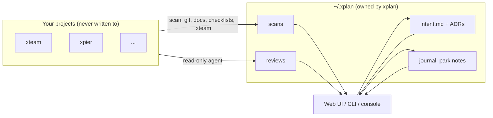
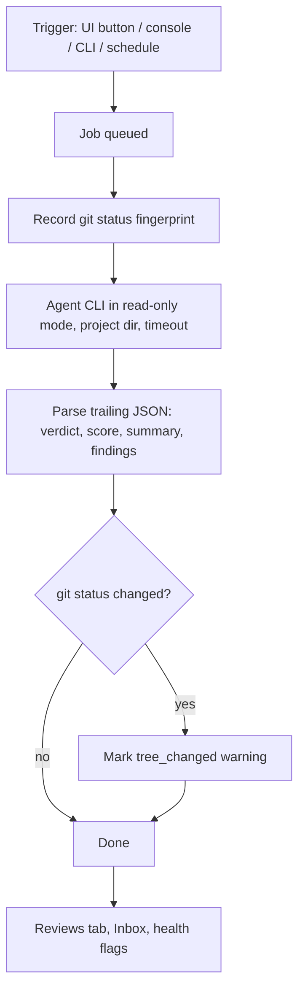

# xplan Features

This file lists every feature of xplan: what it is for, how to use it, its
parameters and what it returns. The design rationale and flowcharts live in
[docs/design.md](docs/design.md).

## 1. Overview

| Area            | What it gives you                                                                |
| --------------- | -------------------------------------------------------------------------------- |
| Registry        | One folder per project under `~/.xplan/projects/<slug>/`                         |
| Intent and ADRs | Why the project exists and the decisions taken, stored outside the project       |
| Scanner         | Git activity, docs by kind, checklist progress, `.xteam` slices, stack           |
| Health          | Flags such as "intent not written", "active but stale", "review needs attention" |
| Re-entry brief  | Intent → park note → what changed since your last visit → health → reviews       |
| Reviews         | Read-only agent reviews: drift, code, security, deploy, test, ask                |
| Console         | Slash commands and free-form questions per project                               |
| Web UI          | IDE layout: sidebar, tabs, board, inbox, palette (⌘K), console (⌘J)              |

## 2. Registry

### 2.1 Register a project

- **UI**: `+` in the sidebar, or ⌘K → "Add project". Paste a folder path, or
  "Discover" a root folder and tick the repositories to add.
- **CLI**: `xplan add <path> [--name NAME]`, `xplan discover <root> [--add]`.
- **API**: `POST /api/projects` with `{"path": "...", "name": "optional"}` →
  `201` with the project. `POST /api/discover` with `{"root": "..."}` → `200`
  with the git repositories found and whether each is registered.

Registration copies the global default schedule into the project, seeds
`intent.md` from a template, takes the summary from the README's first real
sentence (links, HTML and badge lines stripped) and runs a first scan.

### 2.2 Project fields (`project.yaml`)

| Field       | Type             | Meaning                                                         |
| ----------- | ---------------- | --------------------------------------------------------------- |
| `name`      | string           | Display name                                                    |
| `path`      | string           | Absolute path of the project directory                          |
| `status`    | enum             | `active`, `waiting`, `blocked`, `paused`, `done` (board column) |
| `summary`   | string           | One line shown under the name                                   |
| `tags`      | string[]         | Free tags                                                       |
| `reviewer`  | string           | Reviewer preset; empty means the global default                 |
| `schedule`  | map kind → value | `off`, `daily` or `weekly` per review kind                      |
| `doc_globs` | string[]         | Extra globs to collect as docs (relative to the project root)   |

`PATCH /api/projects/{slug}` accepts any subset of these fields (except `path`)
and returns `200` with the updated project. `DELETE /api/projects/{slug}` moves
the project's xplan folder to `~/.xplan/archive/` (nothing is deleted) and
returns `204`.

## 3. Intent and decisions

- **Intent** (`intent.md`): sections Why, Goal, Success, Non-goals, Context.
  The Brief tab shows the first four. Edit in the Intent tab (edit, split or
  preview; ⌘S saves).
  - `GET /api/projects/{slug}/intent` → `{"content": "..."}`
  - `PUT /api/projects/{slug}/intent` with `{"content": "..."}` → `200`
- **ADRs** (`adr/NNNN-title.md`): portfolio-level decisions. The Decisions tab
  also lists the project's own ADR and spec documents (read-only).
  - `POST /api/projects/{slug}/adrs` with `{"title": "...", "context": "..."}` → `201`
  - `PUT /api/projects/{slug}/adrs/{id}` with `{"content": "..."}` → `200`

## 4. Scanner and health

A scan runs on registration, every `scan_interval` (default `15m`), on "Rescan",
on `/scan` and on `xplan scan`. It collects:

| Source         | Collected                                                              |
| -------------- | ---------------------------------------------------------------------- |
| git            | Branch, HEAD, recent commits, uncommitted file count, last commit      |
| Docs           | README, CHANGELOG, specs, ADRs, progress, agent instructions, `.xteam` |
| Checklists     | `- [x]` vs `- [ ]` counts per doc and overall progress                 |
| `.xteam/tasks` | Stage of every slice (open vs done)                                    |
| Stack          | `go.mod`, `composer.json`, `package.json`, Xcode, CI workflows, ...    |

`POST /api/projects/{slug}/scan` → `200` with `scanned_at` and counts.

Health flags (most severe first): `path_missing` (crit), `no_intent`, `stale`
(active but no commit for 14 days), `dirty` (more than 30 files is a warning),
`review_<kind>` (latest verdict attention or critical), `review_failed_<kind>`,
`no_park`, `xteam_open`, `never_scanned`.

## 5. Re-entry brief and park notes

- **Brief tab**: intent card, last park note, "Since your last visit" (commits and
  changed docs since the recorded HEAD), health, latest review per kind,
  checklist progress, decisions.
- **I'm caught up**: `POST /api/projects/{slug}/visit` records now + HEAD.
- **Park note** (before switching away): where you stopped, the next step, open
  questions. The UI's Park button, `/park stopped | next | open`, or
  `xplan park <slug> "stopped | next | open"`. Writing a park note also records
  the visit.
- **Journal**: `GET /api/projects/{slug}/journal?kind=&limit=` →
  `{"entries": [...]}`; `POST` with `{"kind": "park|note", "text", "stopped",
"next", "open"}` → `201`.

## 6. Reviews

| Kind       | Question it answers                                                                |
| ---------- | ---------------------------------------------------------------------------------- |
| `drift`    | Is the project still doing what its intent says? Any concepts from other projects? |
| `code`     | Structure, correctness risks, maintainability                                      |
| `security` | Secrets, injection, auth, dependency risks                                         |
| `deploy`   | Build, configuration, release and rollback readiness                               |
| `test`     | Coverage of critical paths, flaky or missing tests                                 |
| `ask`      | Free-form question (console plain text)                                            |

- **Start**: `POST /api/projects/{slug}/reviews` with `{"kind": "drift"}` or
  `{"kind": "ask", "question": "..."}` → `202` with the job. `409` if the same
  kind is already running for the project.
- **Read**: `GET /api/projects/{slug}/reviews` → `{"jobs": [...]}`;
  `GET /api/projects/{slug}/reviews/{id}` → `{"job", "report"}`; the job has
  `findings`, `verdict` (`ok`, `attention`, `critical`, or `unknown` when the
  agent returned no JSON; drift reviews display them as aligned, drifting and
  off-track), `score` (0–100) and `tree_changed`.
- **Cancel**: `POST /api/projects/{slug}/reviews/{id}/cancel` → `202`.
- **Inbox**: `GET /api/inbox` → open findings across projects, newest first.
- **Report links**: file references such as `/abs/project/bin/x.py:584` open
  the file in the Docs tab; paths outside the project render as plain text.

### Reviewer presets

| Preset         | Command (argv template)                                                                           |
| -------------- | ------------------------------------------------------------------------------------------------- |
| `cursor-agent` | `cursor-agent -p --output-format text --mode ask --trust --workspace {path} {prompt}`             |
| `codex`        | `codex exec --sandbox read-only --skip-git-repo-check -C {path} {prompt}`                         |
| `claude`       | `claude -p {prompt} --allowedTools=Read,Grep,Glob --disallowedTools=Edit,Write,Bash,NotebookEdit` |
| `omp`          | `omp -p --no-session --cwd {path} --tools read,grep,glob {prompt}`                                |

Placeholders: `{prompt}` (prompt text), `{prompt_file}` (path of the prompt file),
`{path}` (project directory). Add your own presets under `reviewers:` in
`~/.xplan/config.yaml`.

## 7. Console

Open with ⌘J. Plain text asks the project's reviewer a read-only question.

| Command      | Arguments                                  | Effect                      |
| ------------ | ------------------------------------------ | --------------------------- |
| `/review`    | `drift\|code\|security\|deploy\|test\|all` | Start reviews               |
| `/ask`       | `<question>`                               | Same as plain text          |
| `/park`      | `stopped [\| next] [\| open]`              | Leave a park note           |
| `/note`      | `<text>`                                   | Journal note                |
| `/adr`       | `<title>`                                  | Create an ADR               |
| `/status`    | `active\|waiting\|blocked\|paused\|done`   | Move on the board           |
| `/scan`      |                                            | Rescan now                  |
| `/caught-up` |                                            | Record the visit            |
| `/xteam`     | `<message>` or `status`                    | Ring the project's xteam PM |
| `/open`      |                                            | Open the project in Cursor  |
| `/help`      |                                            | List commands               |

API: `POST /api/projects/{slug}/console` with `{"input": "..."}` →
`{"ok", "output", "job_id"?, "job_ids"?, "refresh"?}`; `GET` returns
`{"items": [...]}` (history).

## 8. Global settings (`~/.xplan/config.yaml`)

| Key                      | Default                               | Meaning                               |
| ------------------------ | ------------------------------------- | ------------------------------------- |
| `listen`                 | `127.0.0.1:7788`                      | HTTP address                          |
| `scan_interval`          | `15m`                                 | Background rescan period              |
| `review_timeout`         | `20m`                                 | Per-review timeout                    |
| `max_concurrent_reviews` | `2`                                   | Parallel reviews                      |
| `default_reviewer`       | `cursor-agent`                        | Used when a project has no reviewer   |
| `report_language`        | `English`                             | Language the agent writes reports in  |
| `default_schedule`       | drift and security weekly, others off | Copied into newly registered projects |
| `reviewers`              | presets above                         | Agent command templates               |

`GET /api/config`, `PATCH /api/config` (any subset of the editable keys).

## 9. Errors

All API errors return `{"error": "message"}`:

| Status | When                                                                                  |
| ------ | ------------------------------------------------------------------------------------- |
| `400`  | Invalid input (unknown status, bad schedule, empty command)                           |
| `403`  | Non-loopback Host, missing `X-Xplan` header, sensitive file, path outside the project |
| `404`  | Unknown project, review or file                                                       |
| `409`  | The same review kind is already running                                               |
| `415`  | Binary or oversized file                                                              |

## 10. Retrospective (v0.1.0)

**What went well**

- File-as-state made the backend easy to test (temp home per test) and easy to
  inspect by hand.
- The read-only guard proved useful: the first real `codex` drift review on
  xteam finished with `tree_changed: false` and 7 findings that reached the
  Inbox and health flags automatically.

**Problems found**

- Agent CLIs differ in subtle ways. `claude`'s variadic flags swallowed the
  prompt, and `omp` rejected unknown tool names. Each preset needs a smoke test
  with the real binary, not just a review of its documented flags.
- Headless `claude -p` still hangs on this machine (hooks or MCP start-up).
  Use `codex` or `cursor-agent` until that is solved.
- `cursor-agent` needs `cursor-agent login` first. The failure is shown on the
  job, but the UI could say so before the run.
- The UI bundle is about 730 KB (225 KB gzipped). That is fine for a local tool,
  but Markdown rendering could be lazy-loaded.

**Next ideas**

- Let the reviewer draft `intent.md` from the README and history, for the user
  to edit (every project currently shows "Intent not written yet").
- Per-preset "test connection" button in Settings.
- Finding lifecycle (acknowledge or dismiss) so the Inbox only shows new items.
- A changing default schedule could offer to update existing projects.
