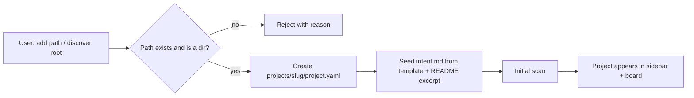
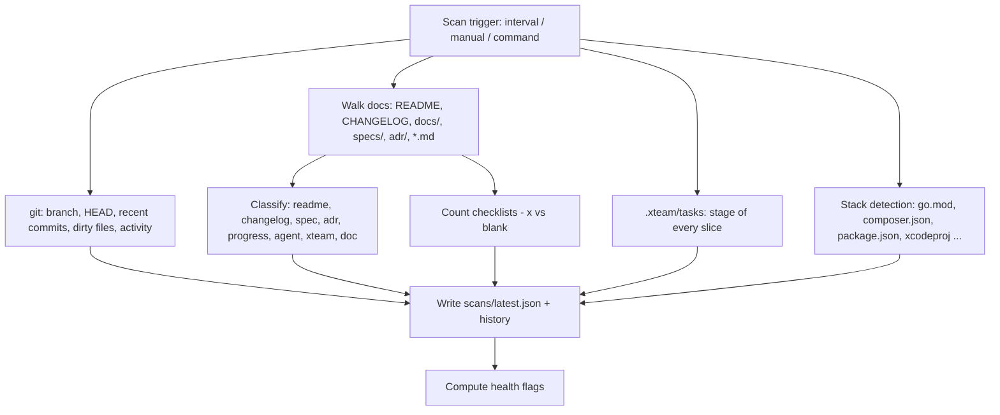
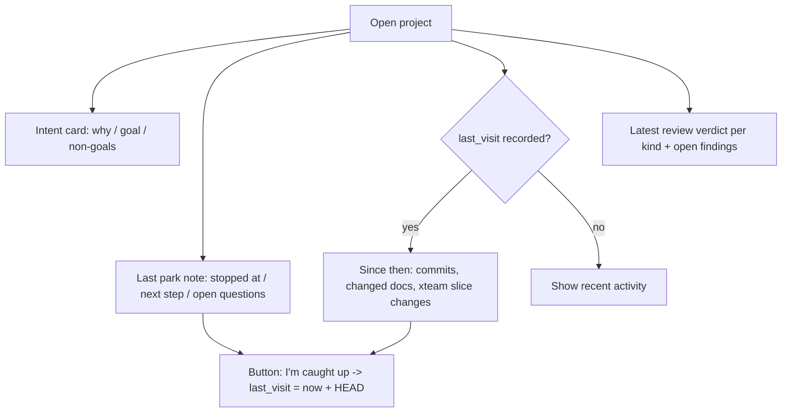
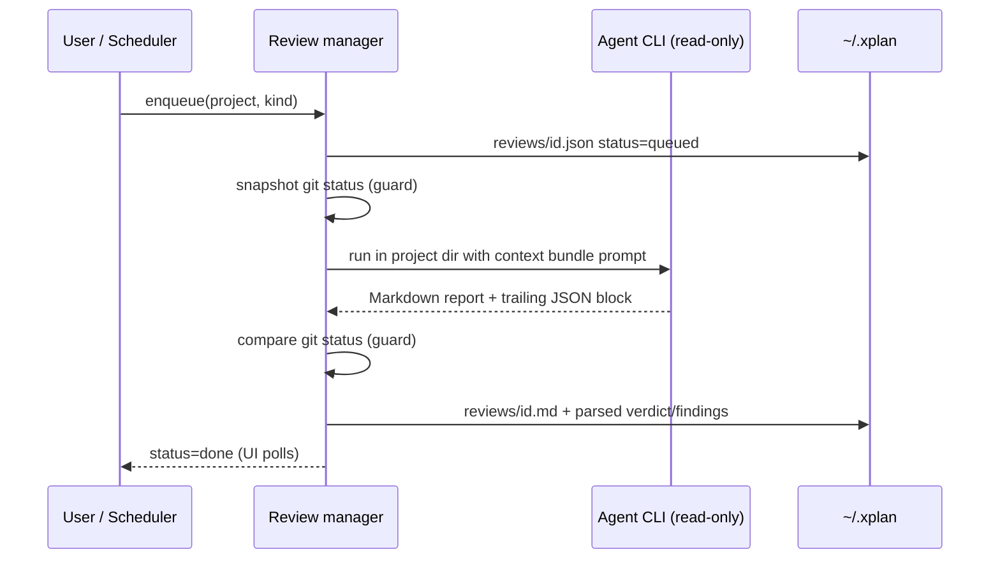
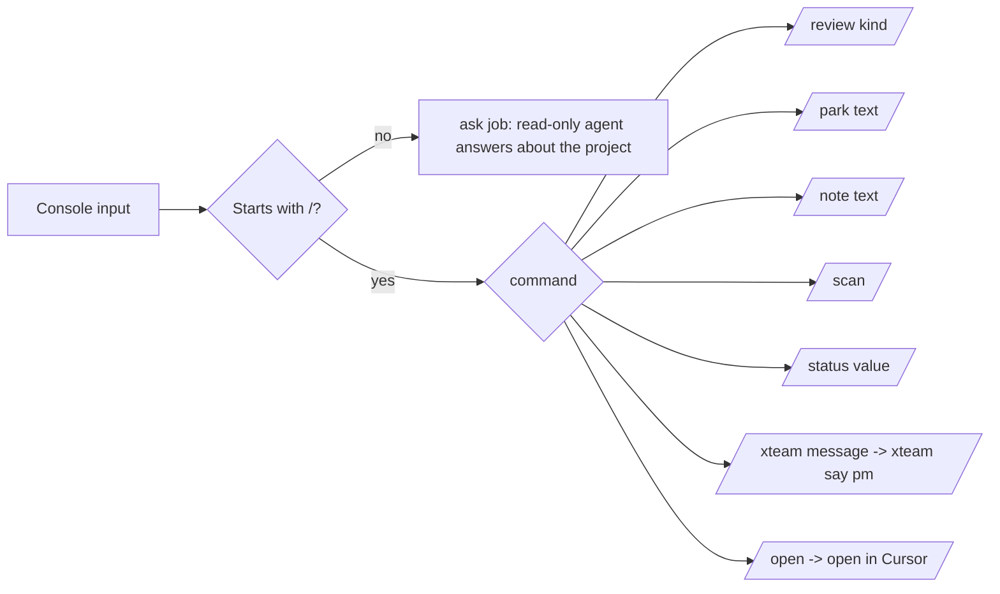

# xplan — Design

> A cockpit that sits **outside** every project you are building in parallel.
> It remembers why each project exists, collects what the project writes about
> itself, shows progress at a glance, and periodically reviews the project from
> the outside with a read-only agent.

## 1. Problem

When several projects are developed in parallel (A waits for an agent, so you
switch to B, then C, D, E), throughput goes up but two things break:

1. **Intent decay** — when you come back to A, the original idea has blurred.
2. **Context contamination** — your head still carries B..E, and those concepts
   leak into A's decisions.

Each project already produces docs (README, specs, ADRs, CHANGELOG, progress
notes, `.xteam/` task archives), but they live inside the project, in different
shapes, and nothing compares them against the original intent.

## 2. Principles

| Principle                    | Consequence                                                                                                                                    |
| ---------------------------- | ---------------------------------------------------------------------------------------------------------------------------------------------- |
| **Outside, read-only**       | xplan never writes into a project directory. Reviews run agents in read-only modes, and a guard flags any working-tree change during a review. |
| **Intent is owned by xplan** | `intent.md` and xplan ADRs live in xplan's home, not in the project, so the project cannot silently rewrite its own origin story.              |
| **State is files**           | Everything is Markdown / YAML / JSON(L) under `~/.xplan`. No database. The home can be put under git.                                          |
| **Re-entry first**           | The default screen of a project is the _re-entry brief_: intent → where you left off → what changed since → health.                            |
| **One binary**               | Go backend with the React UI embedded. `xplan serve` and you are done.                                                                         |

## 3. Storage layout

```text
~/.xplan/                       # XPLAN_HOME
  config.yaml                   # listen addr, scan interval, reviewer presets, default schedule
  projects/
    <slug>/
      project.yaml              # user config: name, path, status, summary, tags, reviewer, schedule
      intent.md                 # why this project exists (owned by xplan)
      adr/0001-<title>.md       # decisions taken at portfolio level
      journal.jsonl             # park notes / notes / command log entries
      state.json                # machine state: last visit (time + HEAD), last scan
      scans/latest.json         # latest scan snapshot
      scans/<ts>.json           # scan history (rotated)
      reviews/<id>.json         # review job metadata + parsed findings
      reviews/<id>.md           # full report from the agent
      reviews/<id>.log          # agent stderr
  archive/                      # unregistered projects are moved here, never deleted
```

## 4. Flows

### 4.1 Register a project



### 4.2 Scan (collect)



### 4.3 Re-entry brief (coming back to a project)



Leaving a project is the mirror image: write a **park note** (where you stopped,
what is next, what is still open). Writing a park note also records the visit.

### 4.4 External review



Review kinds: `code`, `security`, `deploy`, `test`, `drift`, `ask`.
`drift` compares the intent and ADRs against recent commits, docs and tasks, and
explicitly looks for concepts that leaked in from _other_ projects.

### 4.5 Console (issuing commands)



## 5. Security

- Binds to `127.0.0.1` by default.
- Non-GET requests must carry `X-Xplan: 1` (blocks cross-site form posts) and the
  `Host` header must be a loopback name (blocks DNS rebinding).
- File reads are confined to the project root after symlink resolution;
  sensitive files (`.env*`, keys, `secrets/`) are never served.
- Agents are invoked with argv (no shell), with a timeout, and in their
  read-only modes.

## 6. Out of scope (v1)

- Writing code into projects or dispatching write-mode agents (use xteam for that;
  xplan can ring xteam's PM via `/xteam`).
- Multi-user, auth, remote access.
- Content-addressed history of every doc version (git in the project already has it).
